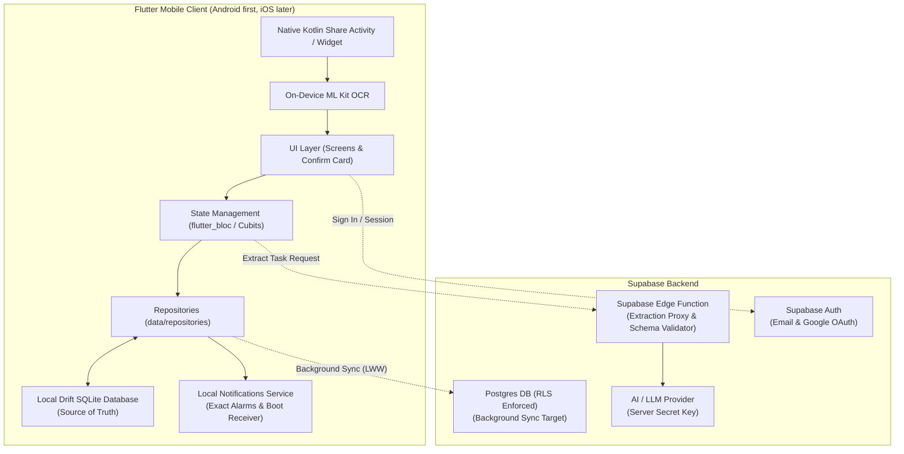

# 🎯 Gotit

[](https://flutter.dev)
[](https://dart.dev)
[](https://github.com/Clark605/gotit/actions/workflows/ci.yml)
[](LICENSE)
[](.specify/memory/constitution.md)

> **Share any messy text, screenshot, or voice note to the app, and AI turns it into a clean task with a due date and a reminder, confirmed in one tap.**

Gotit is an **automation-first task application** designed for busy students and professionals who receive commitments scattered across WhatsApp, Slack, emails, and screenshots. Instead of manually copying notes or forgetting deadlines, users share directly into Gotit. The app structures the task, presents an instant confirm card, and schedules local reminders—completely offline-resilient with local-first storage.

---

## 🚧 Current Status: Phase 1 (Local Foundation, In Progress)

Gotit is actively under development. Rather than claiming a finished v1, this repository documents the engineering progression from local foundation to AI-powered share capture:

- [x] **Local Database (Drift SQLite)**: Fully offline-first schema (`tasks`, `reminders`, `checklist_items`, `contexts`) with reactive streams, migrations, and soft-delete support.
- [x] **State Management & Reliability**: Feature-first `flutter_bloc` Cubits backed by `ActionGuard` for duplicate async action rejection.
- [x] **Core UI & Task Management**: Today view (grouped into Overdue, Due Today, and Start Today), All Tasks list, Task Detail, context tagging, and task creation bottom sheet.
- [x] **Exact Local Reminders**: Reliable scheduling via `flutter_local_notifications`, boot recovery receiver (`BOOT_COMPLETED`), start-working alerts, and battery troubleshooting UI.
- [ ] **Android Native Share Target**: Native Kotlin `ShareActivity` and intent filter to accept text and image shares directly *(Phase 2 - Planned)*.
- [ ] **On-Device OCR**: Offline text recognition with Google ML Kit Text Recognition on Android *(Phase 2 - Planned)*.
- [ ] **Serverless AI Extraction**: Supabase Edge Function proxy with strict JSON schema validation and zero client secrets *(Phase 3 - Planned)*.
- [ ] **One-Tap Confirm Card**: Instant preview with low-confidence field highlighting (< 0.6) and multi-task selection *(Phase 3 - Planned)*.
- [ ] **Cloud Sync & Supabase Auth**: Asynchronous Last-Write-Wins (LWW) Postgres sync with email and Google OAuth *(Phase 4 - Planned)*.
- [ ] **Home-Screen Quick Add Widget**: Native Android home-screen widget for two-tap capture *(Phase 4 - Planned)*.

---

## 📸 App Preview

> *Visual preview of the task workflow, including the Today view, task creation, context tagging, and reminder configuration.*

| Today View (Overdue & Due Today) | Task Creation & Lead Times | Reliability & Troubleshooting |
|:---:|:---:|:---:|
| *(Screenshots coming soon)* | *(Screenshots coming soon)* | *(Screenshots coming soon)* |

---

## 🚀 Planned v1 Scope

The product scope is strictly defined by the [Gotit PRD](docs/prd.md) and governed by the [Project Constitution](.specify/memory/constitution.md).

### 📱 Planned Features Breakdown

| Area | Feature | Specification & Non-Negotiable Rules |
|---|---|---|
| **Capture** | **Android Share Target** | Registers as native Android share target for plain text and images/screenshots; opens directly to the Confirm Card. |
| | **On-Device OCR** | Google ML Kit text recognition runs strictly on-device. Images are never uploaded; only extracted text is processed. |
| | **Manual Task Entry** | Rich manual entry form supporting title, due date/time, context, notes, and checklist items. |
| **Extraction (AI)** | **Serverless AI Extraction** | Supabase Edge Function proxies LLM requests with server-side API keys, strict schema validation, and per-user daily limits. |
| | **Date Precision** | Relative dates in English and Arabic resolve against device date, timezone, and locale. **No date guessing**: omitted dates remain `null`. |
| | **Resilience & Fallback** | 1 automatic retry on malformed output; falls back gracefully to a prefilled manual form if network or extraction fails. |
| | **Multi-Task Extraction** | One shared message can produce multiple discrete tasks, each with independent save/discard controls. |
| **Confirm Card** | **One-Tap Confirmation** | Extracted fields previewed on a single card; fields with model confidence `< 0.6` are visually highlighted for verification. |
| **Task Management** | **Today View** | Groups items into Overdue, Due Today, and Start Today, sorted by urgency. |
| | **Contexts** | Categorization by Work, Home, Personal, and custom labels. |
| | **Instant Rescheduling** | Editing or completing a task updates or cancels scheduled alarms immediately. |
| **Reminders** | **Reliable Alarms** | `flutter_local_notifications` with exact alarms, reboot restoration (`BOOT_COMPLETED`), and graceful fallback to inexact alarms. |
| | **Start-Working Alerts** | Lead-time reminders based on optional effort estimates before the due time. |
| | **Battery Guidance** | Built-in troubleshooting guide for aggressive background app restrictions on OEM devices. |
| **Local-First & Sync** | **Local Source of Truth** | Drift (SQLite) database is the authoritative data source; UI reads exclusively from local tables. |
| | **Background Cloud Sync** | Asynchronous Supabase sync with last-write-wins (LWW) conflict resolution, update timestamps, and soft deletes. |
| **Identity & Privacy** | **Supabase Auth** | Sign-in with Email and Google. |
| | **Row Level Security (RLS)** | Database rows secured so authenticated users can only access their own data. |
| | **Account & Data Purge** | One-tap account deletion completely erases all remote cloud data. |
| **Widget** | **Home-Screen Quick Add** | Native Android home-screen widget opens the quick capture sheet in two taps. |

### 🔮 Future Roadmap

- **v2**:
  - Voice note capture to multiple tasks (speech-to-text pipeline feeding extraction).
  - Waiting-on list (tracking promises made by others).
- **v3**:
  - Receipt and bill photo to expense entry (on-device OCR).
- **Later**:
  - Auto-planned day scheduling into free calendar blocks.
  - Recurring life templates.
  - Opt-in automatic capture.

---

## 🔒 Privacy & Architecture Principles

- **Zero Image Uploads**: Screenshot OCR is executed 100% on the device.
- **Ephemeral AI Processing (Design Goal)**: The backend is architected never to log or store raw shared messages; only tasks the user explicitly reviews and saves are persisted. This will be verified against Supabase Edge Function execution logs and LLM provider data retention terms prior to production.
- **Zero Client Secrets**: No third-party LLM API keys exist in the Flutter binary or client bundle.
- **Offline First**: All task reading, editing, and reminders operate completely offline. Network is only required for AI extraction and background backup sync.
- **Bilingual Excellence**: Full English and Arabic localization with comprehensive Right-to-Left (RTL) layout support.

---

## 🏛️ Technical Stack & Architecture



- **Framework**: Flutter 3.41.1 (Dart 3.11.0)
- **Local Storage**: Drift (SQLite) with reactive streams
- **State Management**: `flutter_bloc` (Cubits/Blocs with `ActionGuard`)
- **Backend & Auth**: Supabase (PostgreSQL with RLS, GoTrue Auth)
- **Extraction Proxy**: Supabase Edge Function (TypeScript) + JSON Schema enforcement
- **Local Alarms**: `flutter_local_notifications` with Android exact alarms and boot receiver
- **OCR Engine**: Google ML Kit Text Recognition (on-device)
- **Architecture**: Feature-first (`data/`, `cubit/`, `ui/`), repository pattern, no separate domain layer

### 🧩 Modular Architecture & Optional Modules

The project maintains a catalog of modular, pluggable reference packages in [`optional_modules/`](optional_modules/) (detailed in [`docs/optional-modules.md`](docs/optional-modules.md)). These include optional or future integrations for Firebase Crashlytics/Analytics, Sentry, deep links, biometric auth, and push notifications, keeping the primary codebase lean until explicitly brought into active feature scope.

---

## 📊 AI Prompt & Extraction Evaluation (Planned)

Once the AI extraction pipeline is integrated, prompt and model iterations will be benchmarked against a curated test suite under `test/eval/` (following the Flutter `test/` convention) with real English and Arabic messages. Accuracy targets:
- **Due Date Precision**: ≥ 85% on messages containing stated deadlines.
- **Title Accuracy**: ≥ 90% on task messages.
- **Non-Task Detection (`no_task_found`)**: ≥ 90% on conversational or non-actionable messages.

Benchmark results will be tracked in the repository to measure and validate continuous accuracy improvements across model revisions.

---

## ⚡ Getting Started

### 1. Prerequisites
- Flutter SDK `^3.41.1`
- Dart SDK `^3.11.0`
- Android Studio / VS Code with Flutter extensions

### 2. Set Up Environment
Generate the environment configuration files from the templates:
```bash
dart run tool/setup_env.dart
```

### 3. Dependencies & Code Generation
```bash
flutter pub get
dart run build_runner build --delete-conflicting-outputs
```

### 4. Run the Dev Flavor
```bash
flutter run --flavor dev --dart-define-from-file=env/dev.json
```

---

## 🧪 Verification & Quality Gates

Before merging any feature, all verification gates must pass:
```bash
# 1. Format verification
dart format --set-exit-if-changed .

# 2. Static analysis
flutter analyze

# 3. Architecture rule compliance
dart run tool/check_architecture.dart

# 4. Unit & widget tests
flutter test
```

---

## 📄 Governance & Standards

- [Product Requirements Document (PRD)](docs/prd.md)
- [Project Constitution](.specify/memory/constitution.md)
- [Architecture & Agent Guidelines](AGENTS.md)
- [Design Tokens & Theming](docs/theming.md)
- [Optional Modules Catalog](docs/optional-modules.md)

---

## ⚖️ License

Distributed under the MIT License. See [LICENSE](LICENSE) for details.
