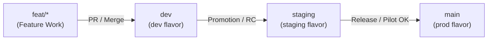

# 🏷️ Gotit Multi-Flavor Versioning & Branching Strategy

This document defines the versioning and branch management model for Gotit across `dev`, `staging`, and `prod` environments. Every branch merge, release build, and tag must adhere to these conventions.

---

## 1. Version Format in Flutter

Flutter encodes application versions in `pubspec.yaml`:
```yaml
version: MAJOR.MINOR.PATCH+BUILD
```

- **`MAJOR.MINOR.PATCH` (Version Name)**:
  - **`MAJOR`**: Substantial architecture overhauls or milestone releases (e.g., `1.0.0` for public v1 MVP).
  - **`MINOR`**: Completion of a new feature phase (e.g., `0.1.0` for Local Tasks, `0.2.0` for Reminders, `0.3.0` for AI Extraction).
  - **`PATCH`**: Bug fixes, minor adjustments, typo corrections, or UI refinements within a phase.
- **`BUILD` (Build Number / Version Code)**:
  - A strictly monotonically increasing positive integer (`1`, `2`, `3`, `4`...).
  - Corresponds directly to Android's `versionCode` and iOS's `CFBundleVersion`.
  - **Must never be reset or decremented**, ensuring upgrade paths on user devices and store approval.

---

## 2. Branch to Flavor & Version Mapping



| Branch | Target Flavor | pubspec.yaml Example | Git Tag Convention | Purpose & Deployment Gate |
|---|---|---|---|---|
| **`feat/<name>`** | `dev` | `0.1.0+1` | *(None)* | Isolated feature development following Spec Kit. |
| **`dev`** | `dev` | `0.1.0+1` | `v0.1.0-dev.1` | Integration branch. Merges increment the build number `+BUILD`. |
| **`staging`** | `staging` | `0.1.0-rc.1+10` | `v0.1.0-rc.1` | Release candidate testing, QA, and closed pilot group testing. |
| **`main`** | `prod` | `0.1.0+15` | `v0.1.0` | Production release. Fully passing tests and architecture checks. |

---

## 3. Versioning Step-by-Step Runbook

### A. When working on a Feature Branch (`feat/<name>`):
1. Branch off `dev`.
2. Keep the current `pubspec.yaml` version of `dev`.
3. Develop and pass all checks (`dart format`, `flutter analyze`, `check_architecture`).

### B. When Merging into `dev`:
1. Check the highest current build number.
2. Increment `BUILD` by 1 in `pubspec.yaml` (e.g. `0.1.0+1` -> `0.1.0+2`).
3. Commit with Conventional Commits: `chore(release): bump dev version to 0.1.0+2`.
4. Create a lightweight or annotated git tag: `git tag v0.1.0-dev.2`.

### C. When Promoting to `staging`:
1. Merge `dev` into `staging`.
2. Update version suffix in `pubspec.yaml` to Release Candidate format (e.g., `0.1.0-rc.1+10`).
3. Tag with `v0.1.0-rc.1`.
4. Deploy staging APK/AAB to internal testers.

### D. When Releasing to `main` (Production):
1. Merge `staging` into `main`.
2. Finalize `pubspec.yaml` to clean SemVer: `0.1.0+15`.
3. Tag with official release tag: `git tag -a v0.1.0 -m "Release v0.1.0: Phase 1 Local Foundation & Task Management"`.

---

## 4. Phase Roadmap Target Versions

| Phase | Milestone Name | Target Version |
|---|---|---|
| **Init** | Template & Architecture Baseline | `0.1.0-dev.1+1` |
| **Phase 1** | Local Foundation & Task Management (`001-local-tasks`) | `0.1.0` |
| **Phase 2** | Local Reminders & Alarms (`002-local-reminders`) | `0.2.0` |
| **Phase 3** | AI Extraction & Confirm Card (`003-ai-extraction`) | `0.3.0` |
| **Phase 4** | Native Android Capture & On-Device OCR (`004-native-capture-ocr`) | `0.4.0` |
| **Phase 5** | Cloud Sync, Auth & Row-Level Security (`005-cloud-sync-auth`) | `0.5.0` |
| **Phase 6** | Home-Screen Widget, RTL Polish & v1 Release | `1.0.0` |
