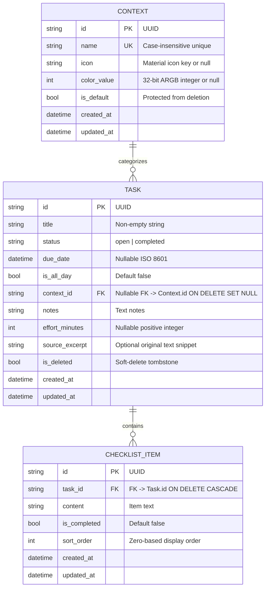
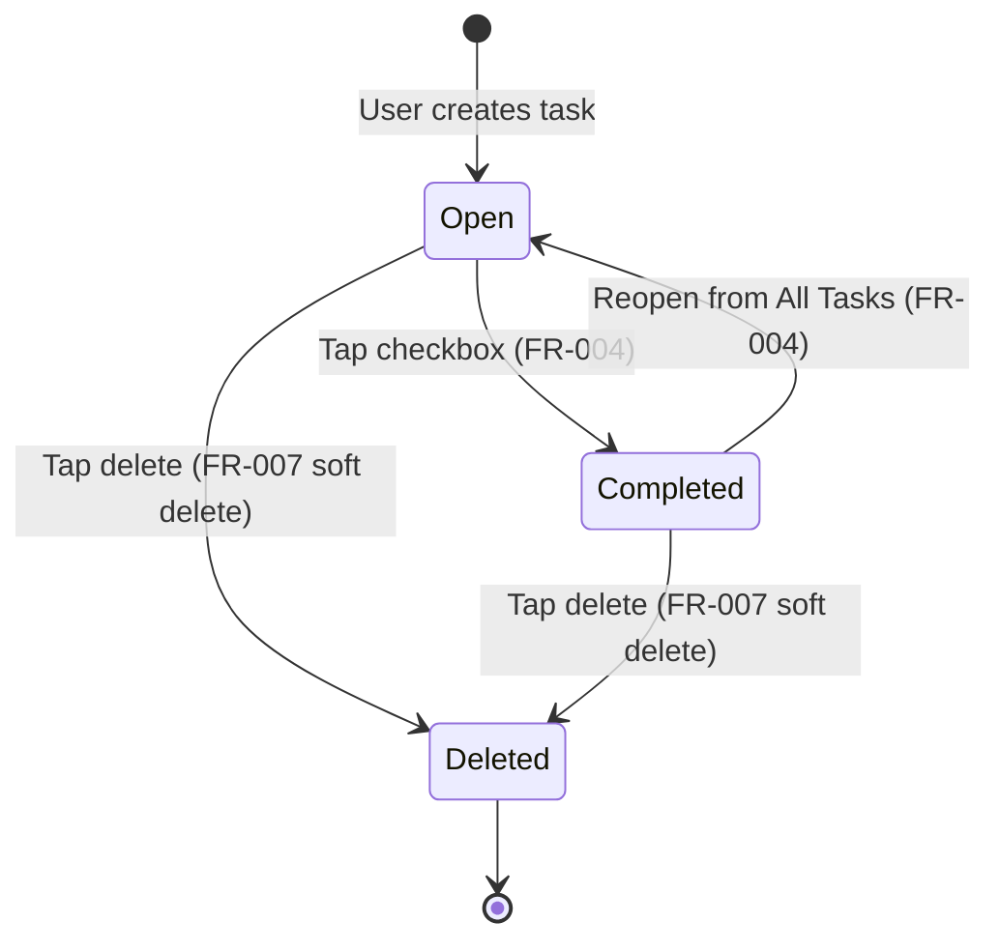

# Data Model: Local Foundation & Task Management (Phase 1)

**Feature**: `specs/001-local-tasks` | **Date**: 2026-11-03

## 1. Domain Entities & Drift Tables

The local persistence layer is implemented in SQLite using Drift (`lib/core/storage/app_database.dart`). 



---

## 2. Table Definitions (Drift Schema)

### 2.1 `ContextsTable`
- **`id`**: `TextColumn` (UUID primary key).
- **`name`**: `TextColumn` (Trimmed label, unique case-insensitively via `collate nocase`).
- **`icon`**: `TextColumn.nullable()` (Optional identifier for custom icon).
- **`colorValue`**: `IntColumn.nullable()` (32-bit ARGB integer value).
- **`isDefault`**: `BoolColumn.withDefault(const Constant(false))` (True for seeded defaults `Work`, `Home`, `Personal`).
- **`createdAt`**: `DateTimeColumn.withDefault(currentDateAndTime)`.
- **`updatedAt`**: `DateTimeColumn.withDefault(currentDateAndTime)`.

**Constraints & Rules**:
- Default contexts cannot be deleted (`isDefault == true`).
- Unique index on `LOWER(TRIM(name))`.

### 2.2 `TasksTable`
- **`id`**: `TextColumn` (UUID primary key).
- **`title`**: `TextColumn` (Must not be empty after trimming).
- **`status`**: `TextColumn` (`open` or `completed`, default `open`).
- **`dueDate`**: `DateTimeColumn.nullable()` (Optional date and optional time).
- **`isAllDay`**: `BoolColumn.withDefault(const Constant(false))`.
- **`contextId`**: `TextColumn.nullable().references(ContextsTable, #id, onDelete: KeyAction.setNull)`.
- **`notes`**: `TextColumn.withDefault(const Constant(''))`.
- **`effortMinutes`**: `IntColumn.nullable()`.
- **`sourceExcerpt`**: `TextColumn.nullable()`.
- **`isDeleted`**: `BoolColumn.withDefault(const Constant(false))` (Soft delete flag).
- **`createdAt`**: `DateTimeColumn.withDefault(currentDateAndTime)`.
- **`updatedAt`**: `DateTimeColumn.withDefault(currentDateAndTime)`.

**Indexes**:
- Index on `[status, isDeleted, dueDate]` (Accelerates Today view queries).
- Index on `[contextId, isDeleted]` (Accelerates context-filtered list queries).

### 2.3 `ChecklistItemsTable`
- **`id`**: `TextColumn` (UUID primary key).
- **`taskId`**: `TextColumn.references(TasksTable, #id, onDelete: KeyAction.cascade)`.
- **`content`**: `TextColumn` (Text of checklist item).
- **`isCompleted`**: `BoolColumn.withDefault(const Constant(false))`.
- **`sortOrder`**: `IntColumn.withDefault(const Constant(0))`.
- **`createdAt`**: `DateTimeColumn.withDefault(currentDateAndTime)`.
- **`updatedAt`**: `DateTimeColumn.withDefault(currentDateAndTime)`.

**Indexes**:
- Index on `[taskId, sortOrder]` (Accelerates sub-item retrieval).

---

## 3. Seed Data (Default Contexts)

On first database initialization (`onCreate`), seed the predefined default contexts:
1. **Work**: `id: 'context-work'`, `name: 'Work'`, `isDefault: true`
2. **Home**: `id: 'context-home'`, `name: 'Home'`, `isDefault: true`
3. **Personal**: `id: 'context-personal'`, `name: 'Personal'`, `isDefault: true`

---

## 4. Freezed Models (Feature Data Layer)

In `lib/features/tasks/data/models/`:

### 4.1 `TaskModel` (`task_model.dart`)
```dart
@freezed
abstract class TaskModel with _$TaskModel {
  const factory TaskModel({
    required String id,
    required String title,
    @Default(TaskStatus.open) TaskStatus status,
    DateTime? dueDate,
    @Default(false) bool isAllDay,
    String? contextId,
    @Default('') String notes,
    int? effortMinutes,
    String? sourceExcerpt,
    @Default(false) bool isDeleted,
    @Default(<ChecklistItemModel>[]) List<ChecklistItemModel> checklist,
    required DateTime createdAt,
    required DateTime updatedAt,
  }) = _TaskModel;

  factory TaskModel.fromJson(Map<String, dynamic> json) => _$TaskModelFromJson(json);
}

enum TaskStatus { open, completed }
```

### 4.2 `ChecklistItemModel` (`checklist_item_model.dart`)
```dart
@freezed
abstract class ChecklistItemModel with _$ChecklistItemModel {
  const factory ChecklistItemModel({
    required String id,
    required String taskId,
    required String content,
    @Default(false) bool isCompleted,
    @Default(0) int sortOrder,
    required DateTime createdAt,
    required DateTime updatedAt,
  }) = _ChecklistItemModel;

  factory ChecklistItemModel.fromJson(Map<String, dynamic> json) => _$ChecklistItemModelFromJson(json);
}
```

### 4.3 `ContextModel` (`context_model.dart`)
```dart
@freezed
abstract class ContextModel with _$ContextModel {
  const factory ContextModel({
    required String id,
    required String name,
    String? icon,
    int? colorValue,
    @Default(false) bool isDefault,
    required DateTime createdAt,
    required DateTime updatedAt,
  }) = _ContextModel;

  factory ContextModel.fromJson(Map<String, dynamic> json) => _$ContextModelFromJson(json);
}
```

---

## 5. Lifecycle & State Transitions

### Task Status Lifecycle


### Checklist Item Lifecycle
- Independent check/uncheck: checking a checklist item does **not** mark the parent task completed (FR-005).
- Reordering: items retain their `sortOrder` index.
- Cascade deletion: deleting a parent task deletes its checklist items from SQLite.
