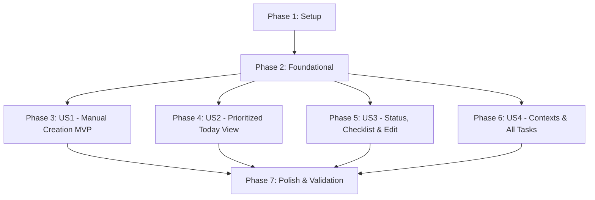

# Tasks: Local Foundation & Task Management (Phase 1)

**Input**: Design documents from `/specs/001-local-tasks/` (`spec.md`, `plan.md`, `data-model.md`, `research.md`, `contracts/`, `quickstart.md`, `design/screens/`)  
**Prerequisites**: `spec.md`, `plan.md`, `data-model.md`, `contracts/`, `DESIGN.md`  
**Constitution Check**: Passed (0 violations)  
**Organization**: Tasks are grouped by user story to enable independent implementation, testing, and MVP delivery.

---

## Format: `- [ ] [TaskID] [P?] [Story?] Description with file path`
- **[P]**: Can run in parallel (different files, no blocking dependencies)
- **[Story]**: User story mapping (`[US1]`, `[US2]`, `[US3]`, `[US4]`). Excluded for Setup, Foundational, and Polish phases.
- Exact file paths included in every task.

---

## Phase 1: Setup (Shared Infrastructure)

**Purpose**: Project initialization, dependencies, design token verification, and localization keys.

- [X] T001 Add Drift, UUID, and dev dependencies (`drift: ^2.24.2`, `drift_flutter: ^0.2.4`, `uuid: ^4.5.1`, `drift_dev: ^2.24.2`) in pubspec.yaml
- [X] T002 Execute dependency retrieval via `flutter pub get`
- [X] T003 [P] Verify and add missing design tokens (paper canvas `#FCFBF9`, hairline `#E7E3DD`, warning amber `#B45309`, accent green `#1F7A5C`, pastel tints) in lib/core/theme/app_colors.dart
- [X] T004 [P] Verify layout tokens (20px sheet radius, 12px FAB radius, 8px button/input radius, 48dp min touch target) in lib/core/theme/app_radius.dart and lib/core/theme/app_spacing.dart
- [X] T005 [P] Add English localization strings for tasks, sections (Overdue, Due Today, Start Today), statuses (Active, Completed, All), and form fields in lib/l10n/app_en.arb
- [X] T006 [P] Add Arabic localization strings with RTL terms (اليوم, المتأخرة, البدء اليوم, المهام, النشطة, المكتملة) in lib/l10n/app_ar.arb

---

## Phase 2: Foundational (Blocking Prerequisites)

**Purpose**: Local SQLite database tables, Freezed models, repository contracts, and shared design system widgets.

**⚠️ CRITICAL**: No user story work can begin until this phase is complete.

- [X] T007 Define Drift database schema with `ContextsTable` (`id` Text UUID PK, `name` Text UK collate nocase, `icon` Text nullable, `colorValue` Int nullable, `isDefault` Bool default false, `createdAt`, `updatedAt`; seed Work, Home, Personal defaults on create), `TasksTable` (`id` Text UUID PK, `title` Text non-empty, `status` Text default 'open', `dueDate` DateTime nullable, `isAllDay` Bool default false, `contextId` Text nullable references ContextsTable ON DELETE SET NULL, `notes` Text default '', `effortMinutes` Int nullable, `sourceExcerpt` Text nullable, `isDeleted` Bool default false, index on `[status, isDeleted, dueDate]`), and `ChecklistItemsTable` (`id` Text UUID PK, `taskId` Text references TasksTable ON DELETE CASCADE, `content` Text, `isCompleted` Bool default false, `sortOrder` Int default 0, index on `[taskId, sortOrder]`) in lib/core/storage/app_database.dart
- [X] T008 Run code generation to generate Drift database code in lib/core/storage/app_database.g.dart
- [X] T009 [P] Create Freezed model for `TaskModel` with `id`, `title`, `status` (open, completed), `dueDate`, `isAllDay`, `contextId`, `notes`, `effortMinutes`, `sourceExcerpt`, `isDeleted`, `checklist`, `createdAt`, `updatedAt` in lib/features/tasks/data/models/task_model.dart
- [X] T010 [P] Create Freezed model for `ChecklistItemModel` with `id`, `taskId`, `content`, `isCompleted`, `sortOrder`, `createdAt`, `updatedAt` in lib/features/tasks/data/models/checklist_item_model.dart
- [X] T011 [P] Create Freezed model for `ContextModel` with `id`, `name`, `icon`, `colorValue`, `isDefault`, `createdAt`, `updatedAt` in lib/features/tasks/data/models/context_model.dart
- [X] T012 Run code generation for Freezed models (`*.freezed.dart`, `*.g.dart`) via `dart run build_runner build --delete-conflicting-outputs`
- [X] T013 Create data source interface `TaskLocalDataSource` matching contract in lib/features/tasks/data/datasources/task_local_data_source.dart
- [X] T014 Implement `TaskLocalDataSourceImpl` using `AppDatabase` queries, stream watches, and transactions in lib/features/tasks/data/datasources/task_local_data_source_impl.dart
- [X] T015 Create repository interface `TaskRepository` returning plain `Future<T>` and `Stream<T>` matching contract in lib/features/tasks/data/repositories/task_repository.dart
- [X] T016 Implement `TaskRepositoryImpl` with `@LazySingleton(as: TaskRepository)` throwing exceptions on error in lib/features/tasks/data/repositories/task_repository_impl.dart
- [X] T017 Register route names (`RouteNames.today = '/today'`, `RouteNames.allTasks = '/tasks'`, `RouteNames.taskDetail = '/task-detail'`) in lib/core/routes/route_names.dart
- [X] T018 Register DI and route providers in lib/core/routes/route_providers.dart and lib/core/di/injection.dart
- [X] T019 [P] Implement shared `ContextTag` widget displaying pastel tint background and dark text per DESIGN.md in lib/features/tasks/ui/widgets/context_tag.dart
- [X] T020 [P] Implement shared `TodaySectionHeader` widget displaying steel caption-bold count or amber warning for Overdue in lib/features/tasks/ui/widgets/today_section_header.dart
- [X] T021 [P] Implement shared `TaskCard` row widget with 24px circular checkbox in 48dp target, title, and metadata badges in lib/features/tasks/ui/widgets/task_card.dart
- [X] T022 [P] Implement shared `AddButton` (56dp square FAB with 12px corners in `#1F7A5C`) in lib/features/tasks/ui/widgets/add_button.dart
- [X] T023 [P] Implement shared `BottomNavBar` with Today and Tasks tabs and hairline top border in lib/features/tasks/ui/widgets/bottom_nav_bar.dart
- [X] T024 [P] Implement shared `EmptyStateWidget` with line illustration and action button in lib/features/tasks/ui/widgets/empty_state_widget.dart
- [X] T025 [P] Implement shared `SnackbarWithUndo` widget for delete confirmation in lib/features/tasks/ui/widgets/snackbar_with_undo.dart
- [X] T026 [P] Add component golden tests for shared widgets in test/features/tasks/ui/widgets/shared_widgets_golden_test.dart

**Checkpoint**: Core persistence, models, repository, routes, and shared design widgets ready. User story implementation can now begin.

---

## Phase 3: User Story 1 - Create and View Tasks Manually (Priority: P1) 🎯 MVP

**Goal**: Enable users to manually create tasks with title, due date, context, notes, effort estimate, and checklist items, persisting offline across restarts.

**Independent Test**: Launch app offline, tap Add Task (+), enter title "Submit assignment", select due date and context, add checklist items, save, and verify persistence after app restart.

### Tests for User Story 1 ⚠️
- [X] T027 [P] [US1] Unit test `TaskRepository.createTask` and checklist persistence in test/features/tasks/data/repositories/task_repository_create_test.dart
- [X] T028 [P] [US1] Bloc test `TaskFormCubit` (initial state, field updates, title validation error, successful save) in test/features/tasks/cubit/task_form_cubit_test.dart

### Implementation for User Story 1
- [X] T029 [US1] Create Freezed `TaskFormState` with `LoadStatus`, form fields (`title`, `dueDate`, `isAllDay`, `contextId`, `notes`, `effortMinutes`, `checklistDrafts`), `titleError`, and `failure` in lib/features/tasks/cubit/task_form_state.dart
- [X] T030 [US1] Implement `TaskFormCubit` extending `BaseCubit<TaskFormState>` with `ActionGuard`, field mutators, non-empty title validation (FR-010), and save in lib/features/tasks/cubit/task_form_cubit.dart
- [X] T031 [US1] Implement `TaskFormSheet` modal bottom sheet (20px top corners, auto-focused title input, date/all-day switch, context chips, effort chips, checklist editor with drag handles, 48dp green Save button matching `04-form-english-light.png` and `04-form-validation-light.png`) in lib/features/tasks/ui/widgets/task_form_sheet.dart
- [X] T032 [US1] Add golden test for `TaskFormSheet` (English, Arabic RTL, validation error, dark theme) comparing against approved mockups in test/features/tasks/ui/widgets/task_form_sheet_golden_test.dart

**Checkpoint**: User Story 1 complete and independently testable as an MVP. Manual task creation and local persistence verified offline.

---

## Phase 4: User Story 2 - Prioritized Today View (Priority: P2)

**Goal**: Deliver the primary Today screen grouping tasks into Overdue, Due Today (all-day first, then chronologically), and Start Today (`dueDate - effort <= today`).

**Independent Test**: Create overdue tasks, tasks due today (timed and all-day), and future tasks with effort estimates. Open Today screen and verify grouping, section headers with counts, and ordering.

### Tests for User Story 2 ⚠️
- [X] T033 [P] [US2] Unit test Today view grouping (Overdue, Due Today, Start Today) and sorting (all-day first, then chronologically) in test/features/tasks/cubit/tasks_cubit_today_test.dart

### Implementation for User Story 2
- [X] T034 [US2] Create Freezed `TasksState` with `LoadStatus`, `todayTasks`, `allTasks`, `contexts`, `selectedContextId`, `selectedStatusFilter`, and `failure` in lib/features/tasks/cubit/tasks_state.dart
- [X] T035 [US2] Implement `TasksCubit` extending `BaseCubit<TasksState>` with `initSubscriptions()`, `watchTodayTasks()` subscription, and `toggleTaskStatus()` in lib/features/tasks/cubit/tasks_cubit.dart
- [X] T036 [US2] Implement `TodayScreen` scaffold with date header, Overdue section (amber warning `#B45309`), Due Today section, Start Today section, EmptyStateWidget, AddButton FAB, and BottomNavBar matching `01-today-english-light.png` and `01-today-arabic-light.png` in lib/features/tasks/ui/today_screen.dart
- [X] T037 [US2] Add dynamic midnight roll recalculation listener in lib/features/tasks/ui/today_screen.dart
- [X] T038 [US2] Add golden test for `TodayScreen` (Light, Dark, Arabic RTL, Empty state) verified against approved Stitch mockups in test/features/tasks/ui/today_screen_golden_test.dart

**Checkpoint**: User Stories 1 AND 2 fully functional. Tasks created via Form Sheet immediately appear in Today view's grouped sections.

---

## Phase 5: User Story 3 - Task Status Toggling, Checklist Progression & Editing (Priority: P3)

**Goal**: Allow users to mark tasks completed with one tap (<50ms), check off checklist sub-items independently, view task details, edit attributes, and delete tasks.

**Independent Test**: Tap task completion checkbox to verify instant completion animation and removal from Today view. Open task detail screen, check a checklist sub-item, edit title/context, and delete task.

### Tests for User Story 3 ⚠️
- [X] T039 [P] [US3] Unit test checklist independent toggle (FR-005) and soft delete (FR-007) in test/features/tasks/data/repositories/task_detail_repository_test.dart
- [X] T040 [P] [US3] Widget test for single-tap completion and checklist checkoff in test/features/tasks/ui/task_status_toggle_test.dart

### Implementation for User Story 3
- [X] T041 [US3] Create typed navigation arguments `TaskDetailArgs` in lib/features/tasks/ui/task_detail_args.dart
- [X] T042 [US3] Implement `TaskDetailScreen` (app bar with back chevron and edit/delete actions, context tag, 22px semibold title, schedule/effort card, notes card, interactive checklist item rows matching `03-detail-english-light.png` and `03-detail-arabic-light.png`) in lib/features/tasks/ui/task_detail_screen.dart
- [X] T043 [US3] Wire `TaskDetailScreen` delete action with confirmation dialog, soft-delete execution, and `SnackbarWithUndo` in lib/features/tasks/ui/task_detail_screen.dart
- [X] T044 [US3] Wire `TaskDetailScreen` edit action to open `TaskFormSheet` pre-populated with task data in lib/features/tasks/ui/task_detail_screen.dart
- [X] T045 [US3] Add golden test for `TaskDetailScreen` (Light, Dark, Arabic RTL) verified against approved Stitch mockups in test/features/tasks/ui/task_detail_screen_golden_test.dart

**Checkpoint**: User Stories 1, 2, and 3 complete. Task lifecycle (create, view, check off, edit, delete, undo) operational.

---

## Phase 6: User Story 4 - Categorization by Contexts & All Tasks Filtering (Priority: P4)

**Goal**: Categorize tasks into contexts (Work, Home, Personal, custom tags), filter All Tasks by context and status (Active, Completed, All), and safely delete custom contexts.

**Independent Test**: Filter All Tasks screen by context chip; toggle status filter to "Completed" to reopen a task; create custom context with duplicate name to verify case-insensitive validation; delete custom context and verify tasks set to No Context.

### Tests for User Story 4 ⚠️
- [X] T046 [P] [US4] Unit test context case-insensitive uniqueness validation and safe unassign on delete in test/features/tasks/data/repositories/context_repository_test.dart
- [X] T047 [P] [US4] Widget test All Tasks screen status filter (Active, Completed, All) and context chip filtering in test/features/tasks/ui/all_tasks_filter_test.dart

### Implementation for User Story 4
- [X] T048 [US4] Implement `ContextFilterBar` horizontally scrollable chip row with color indicators ("All", "Work", "Home", "Personal", custom tags, "+ New") in lib/features/tasks/ui/widgets/context_filter_bar.dart
- [X] T049 [US4] Implement `StatusSegmentedButton` segmented pill control (`Active`, `Completed`, `All`) in lib/features/tasks/ui/widgets/status_segmented_button.dart
- [X] T050 [US4] Implement `DailyProgressBanner` completion ratio indicator matching approved Stitch mockup in lib/features/tasks/ui/widgets/daily_progress_banner.dart
- [X] T051 [US4] Implement `AllTasksScreen` with app bar, ContextFilterBar, StatusSegmentedButton, task list, DailyProgressBanner, AddButton, and BottomNavBar matching `02-tasks-english-light.png` and `02-tasks-completed-light.png` in lib/features/tasks/ui/all_tasks_screen.dart
- [X] T052 [US4] Implement `ContextManagementSheet` (predefined defaults with lock icons, custom contexts with delete action, add context form with name input and pastel color picker matching `05-contexts-*.png`) in lib/features/tasks/ui/widgets/context_management_sheet.dart
- [X] T053 [US4] Implement delete confirmation dialog in `ContextManagementSheet` confirming tasks are unassigned to No Context (Clarification Q3) in lib/features/tasks/ui/widgets/context_management_sheet.dart
- [X] T054 [US4] Add golden test for `AllTasksScreen` (Active, Completed, Dark, Arabic RTL) in test/features/tasks/ui/all_tasks_screen_golden_test.dart
- [X] T055 [US4] Add golden test for `ContextManagementSheet` (List, Delete Modal, Arabic RTL) in test/features/tasks/ui/widgets/context_management_sheet_golden_test.dart

**Checkpoint**: All 4 user stories fully functional, tested, and verified against approved Stitch visual designs.

---

## Phase 7: Polish & Cross-Cutting Concerns

**Purpose**: System integration, template transition, architecture checks, and end-to-end validation.

- [X] T056 Transition template entry point: Update AppRouter home route to `TodayScreen` (`RouteNames.today`) and wire bottom navigation routing in lib/core/routes/app_router.dart
- [X] T057 Run code generation and dependency injection assembly via `dart run build_runner build --delete-conflicting-outputs`
- [X] T058 Run `dart format .` and ensure clean formatting across all modified files
- [X] T059 Run `flutter analyze` and resolve all issues (must be 0 errors, 0 warnings, 0 lints)
- [X] T060 Run `dart run tool/check_architecture.dart` and verify 0 architecture rule violations
- [X] T061 Run full test suite via `flutter test` and verify 100% pass rate
- [X] T062 Execute end-to-end quickstart validation scenarios 1–5 from specs/001-local-tasks/quickstart.md (offline creation, Today grouping, status toggle, safe context unassign, Arabic RTL & text scaling)

---

## Dependencies & Execution Order

### Phase Dependencies
- **Phase 1 (Setup)**: Can start immediately. No prerequisites.
- **Phase 2 (Foundational)**: Depends on Phase 1 completion. **BLOCKS** all user stories.
- **Phase 3 (User Story 1 - P1 🎯 MVP)**: Depends on Phase 2. Can be implemented and verified as a standalone MVP.
- **Phase 4 (User Story 2 - P2)**: Depends on Phase 2 and integrates with US1 tasks for Today presentation.
- **Phase 5 (User Story 3 - P3)**: Depends on Phase 2 and integrates with US1/US2 tasks for detail view and editing.
- **Phase 6 (User Story 4 - P4)**: Depends on Phase 2 and integrates with US1–US3 for context filtering and catalog view.
- **Phase 7 (Polish)**: Depends on all user story phases (Phases 3–6) being complete.

### Parallel Execution Opportunities

- **Phase 1 (Setup)**: T003, T004, T005, T006 can run in parallel.
- **Phase 2 (Foundational)**:
  - Models T009, T010, T011 can run in parallel.
  - Shared widgets T019, T020, T021, T022, T023, T024, T025 can run in parallel.
- **Phase 3–6 (User Stories)**:
  - Tests (marked `[P]`) can be written in parallel before implementation.
  - Once Phase 2 is complete, different user stories can be developed in parallel by independent developers or agents.

---

## Implementation Strategy

### MVP Milestone (Phases 1, 2, & 3)
1. Complete Phase 1 (Setup: tokens, dependencies, l10n).
2. Complete Phase 2 (Foundational: Drift database, Freezed models, repository, shared widgets).
3. Complete Phase 3 (User Story 1: `TaskFormSheet`, `TaskFormCubit`, manual task creation).
4. **VALIDATE MVP**: Verify offline task creation and local persistence across app restarts.

### Incremental Delivery (Phases 4, 5, 6, & 7)
1. Add Phase 4 (User Story 2): Today screen with Overdue, Due Today, and Start Today sections.
2. Add Phase 5 (User Story 3): Task detail screen, independent checklist toggling, editing, and soft deletion.
3. Add Phase 6 (User Story 4): All Tasks catalog with context chips, status segmented filter, and context management.
4. Run Phase 7 (Polish): Quality gates (`flutter analyze`, `check_architecture`, `flutter test`, `quickstart.md`).
