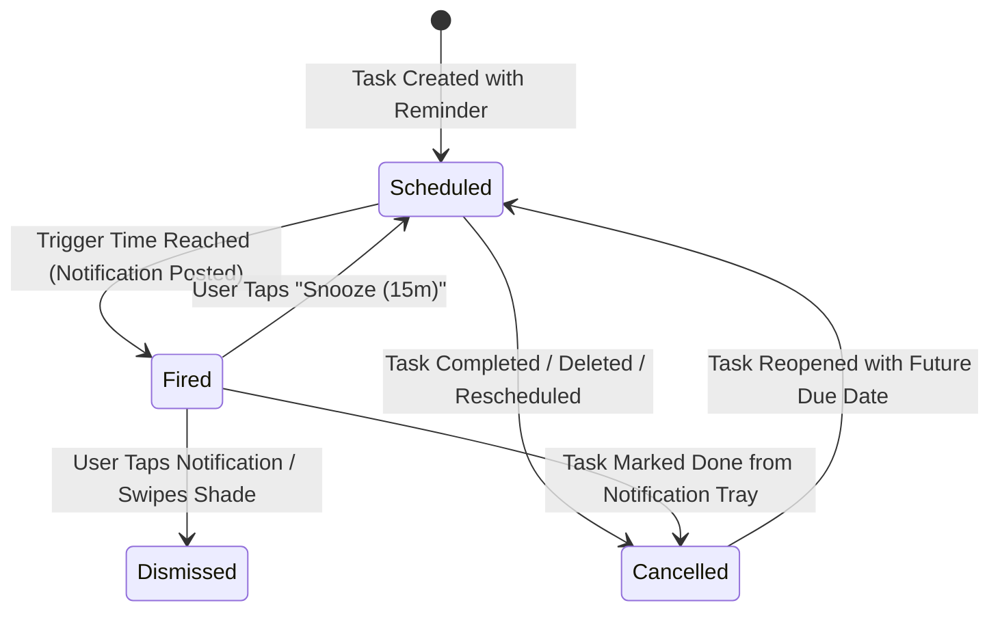

# Data Model: Resilient Task Reminders & Notifications (Phase 2)

**Feature**: [spec.md](spec.md) | **Plan**: [plan.md](plan.md)  
**Date**: 2026-11-04

---

## 1. Domain Entities & Freezed Models

### `ReminderModel`
Represents an individual scheduled or historical alarm event tied to a task.

```dart
enum ReminderType {
  @JsonValue('due')
  due,
  @JsonValue('start_working')
  startWorking,
}

enum ReminderStatus {
  @JsonValue('pending')
  pending,
  @JsonValue('fired')
  fired,
  @JsonValue('cancelled')
  cancelled,
  @JsonValue('dismissed')
  dismissed,
}

@freezed
abstract class ReminderModel with _$ReminderModel {
  const factory ReminderModel({
    required String id,
    required String taskId,
    required ReminderType type,
    required DateTime scheduledTime,
    @Default(0) int leadTimeMinutes,
    @Default(ReminderStatus.pending) ReminderStatus status,
    required int notificationId,
    required DateTime createdAt,
    required DateTime updatedAt,
  }) = _ReminderModel;

  factory ReminderModel.fromJson(Map<String, dynamic> json) =>
      _$ReminderModelFromJson(json);
}
```

### `TaskModel` (Extended from Phase 1)
Updated to store task-level reminder preferences directly:

```dart
@freezed
abstract class TaskModel with _$TaskModel {
  const factory TaskModel({
    required String id,
    required String title,
    @Default(TaskStatus.open) TaskStatus status,
    DateTime? dueDate,
    @Default(false) bool isAllDay,
    String? contextId,
    @Default('') String notes,
    int? effortMinutes,
    String? sourceExcerpt,
    @Default(false) bool isDeleted,
    @Default(<ChecklistItemModel>[]) List<ChecklistItemModel> checklist,
    // Phase 2 additions:
    @Default(false) bool isReminderEnabled,
    int? reminderLeadMinutes,      // null = uses default (15m) or custom lead time
    String? allDayReminderTime,    // e.g. "09:00", null = uses user default
    required DateTime createdAt,
    required DateTime updatedAt,
  }) = _TaskModel;

  factory TaskModel.fromJson(Map<String, dynamic> json) =>
      _$TaskModelFromJson(json);
}
```

### `ReminderPreferences`
User-level defaults stored in `PrefsService` (`SharedPreferences`):

| Key | Type | Default | Description |
| :--- | :--- | :--- | :--- |
| `pref_reminder_default_lead_minutes` | `int` | `15` | Preselected lead time when reminders are toggled on. |
| `pref_reminder_default_all_day_time` | `String` | `"09:00"` | Standard hour/minute string for all-day reminders. |
| `pref_exact_alarm_fallback_acknowledged` | `bool` | `false` | Whether user dismissed the inexact fallback banner. |

---

## 2. Drift SQLite Tables (`lib/core/storage/app_database.dart`)

### `TasksTable` Updates
Schema Version: `2` (upgraded from `1`).

```dart
class TasksTable extends Table {
  // Existing columns:
  TextColumn get id => text()();
  TextColumn get title => text()();
  TextColumn get status => text().withDefault(const Constant('open'))();
  DateTimeColumn get dueDate => dateTime().nullable()();
  BoolColumn get isAllDay => boolean().withDefault(const Constant(false))();
  TextColumn get contextId => text().nullable().references(
    ContextsTable,
    #id,
    onDelete: KeyAction.setNull,
  )();
  TextColumn get notes => text().withDefault(const Constant(''))();
  IntColumn get effortMinutes => integer().nullable()();
  TextColumn get sourceExcerpt => text().nullable()();
  BoolColumn get isDeleted => boolean().withDefault(const Constant(false))();
  DateTimeColumn get createdAt => dateTime().withDefault(currentDateAndTime)();
  DateTimeColumn get updatedAt => dateTime().withDefault(currentDateAndTime)();

  // Phase 2 additions:
  BoolColumn get isReminderEnabled =>
      boolean().withDefault(const Constant(false))();
  IntColumn get reminderLeadMinutes => integer().nullable()();
  TextColumn get allDayReminderTime => text().nullable()();

  @override
  Set<Column> get primaryKey => {id};
}
```

### `RemindersTable`
```dart
@TableIndex(name: 'reminders_task_idx', columns: {#taskId})
@TableIndex(name: 'reminders_status_time_idx', columns: {#status, #scheduledTime})
class RemindersTable extends Table {
  TextColumn get id => text()();
  TextColumn get taskId =>
      text().references(TasksTable, #id, onDelete: KeyAction.cascade)();
  TextColumn get type => text()(); // 'due' or 'start_working'
  DateTimeColumn get scheduledTime => dateTime()();
  IntColumn get leadTimeMinutes => integer().withDefault(const Constant(0))();
  TextColumn get status => text().withDefault(const Constant('pending'))();
  IntColumn get notificationId => integer()();
  DateTimeColumn get createdAt => dateTime().withDefault(currentDateAndTime)();
  DateTimeColumn get updatedAt => dateTime().withDefault(currentDateAndTime)();

  @override
  Set<Column> get primaryKey => {id};
}
```

---

## 3. Lifecycle Transitions & Synchronization Rules



1. **Trigger Calculation**:
   - For specific time:
     - Due Reminder Time = `dueDate - Duration(minutes: leadTimeMinutes)`
     - Start-Working Reminder Time = `dueDate - Duration(minutes: effortMinutes)`
   - For all-day:
     - Due Reminder Time = `DateTime(dueDate.year, dueDate.month, dueDate.day, parsedHour, parsedMinute)`
2. **Deterministic Notification IDs**:
   - `notificationId` generated deterministically: `(taskId.hashCode ^ (type == ReminderType.due ? 0x1000 : 0x2000)) & 0x7FFFFFFF` to prevent collisions.
3. **Immediate Invalidation**:
   - Marking a task completed or deleting it immediately invokes `reminderService.cancelForTask(taskId)` and marks rows as `cancelled`.
