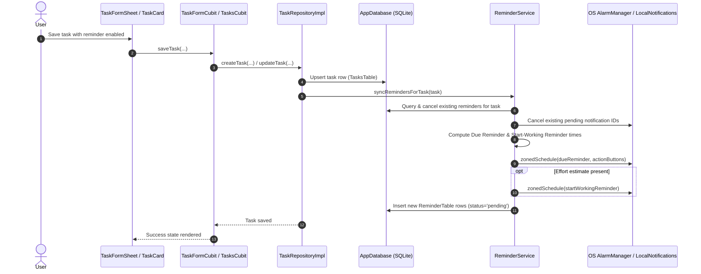

# Implementation Plan: Resilient Task Reminders & Notifications (Phase 2)

**Branch**: `002-task-reminders` | **Date**: 2026-11-04 | **Spec**: [spec.md](spec.md)

**Input**: Feature specification from `specs/002-task-reminders/spec.md`

---

## Summary

Phase 2 implements dependable, local-first reminder and alarm scheduling for Gotit tasks. Users can attach due reminders with configurable lead times (defaulting to 15m or custom), schedule automatic "Start-Working" reminders derived from effort estimates (`dueDate - effort`), interact with notifications directly via lock screen actions ("Mark as Done" and "Snooze 15m"), recover schedules after device reboots, and access guided battery optimization and permission educational flows. All scheduling logic is strictly encapsulated in a dedicated `ReminderService` (`lib/core/services/reminder_service.dart`) backed by SQLite (`RemindersTable`) and `flutter_local_notifications`, adhering strictly to Constitution Principle V and the 8 Golden Rules.

---

## Technical Context

**Language/Version**: Dart 3.11+ / Flutter 3.41.1  
**Primary Dependencies**:
- `flutter_local_notifications`: `^18.0.1` (Local notifications, alarm scheduling, background action dispatch, boot receiver)
- `timezone`: `^0.10.0` (Timezone-aware scheduling for `zonedSchedule`)
- `drift`: `^2.24.2` & `drift_flutter`: `^0.2.4` (SQLite table & migrations)
- `flutter_bloc`: `^9.1.1` (State management)
- `freezed_annotation`: `^3.1.0` (Immutable state & models)
- `injectable`: `^3.0.0` & `get_it`: `^9.3.0` (Dependency injection)

**Storage**: Drift SQLite (`RemindersTable`, updated `TasksTable`, schema version 2) + `PrefsService` for reminder preferences.  
**Testing**: `flutter_test` (Unit tests for `ReminderService`, Drift migration tests, widget tests in English & Arabic).  
**Target Platform**: Android (API 26–35) and iOS 15+; offline-first.  
**Project Type**: Mobile Application (`lib/features/tasks/`, `lib/core/services/`, `lib/core/storage/`).  
**Performance Goals**:
- Alarm cancellation/rescheduling executed in < 150ms upon task modification.
- Boot-time schedule reconciliation for up to 500 tasks completed in < 30 seconds.
- 100% exact alarm dispatch within 5 seconds of target timestamp when exact alarm permissions are granted.

**Constraints**:
- 100% offline-capable; zero network calls for scheduling or dismissing reminders.
- Graceful degradation to inexact alarms when exact alarm permission is restricted or denied.
- Zero duplicate or ghost notifications for completed/deleted tasks.
- Touch targets >= 48px; full English and Arabic (RTL) localization.

---

## Constitution Check

*GATE: Must pass before Phase 0 research. Re-checked after Phase 1 design.*

| Principle | Requirement | Status | Rationale / Compliance Evidence |
| :--- | :--- | :---: | :--- |
| **I. Purpose & Scope** | PRD alignment | **PASS** | Directly implements PRD Section 6.4 (FR-13 to FR-18) and spec requirements FR-001 through FR-013. |
| **II. Absolute Privacy** | No cloud leakage | **PASS** | All reminder scheduling and alarm data remains strictly on-device in SQLite. No reminder data transmitted over network. |
| **III. Local-First Data** | Offline resilience | **PASS** | Uses Drift SQLite (`RemindersTable`) as authoritative source of truth. Reminders work 100% offline. |
| **IV. AI Extraction** | Schema validation | **PASS** | N/A for Phase 2 (AI extraction is Phase 3). |
| **V. Resilient Reminders** | Dedicated service & boot persistence | **PASS** | All logic encapsulated in `ReminderService` covered by unit tests; boot receiver restores schedule; immediate reschedule on task edit/complete; graceful inexact alarm fallback; pre-permission educational primers. |
| **VI. Architecture** | Golden Rules & layers | **PASS** | No domain layer. `TaskRepository` interface coordinates with `ReminderService`. Cubits remain thin. UI never imports service implementations or DI directly. |
| **VII. Quality & Hygiene** | Dependency justification & tests | **PASS** | Explicit justifications for `flutter_local_notifications` and `timezone` in `research.md`. Comprehensive test suite planned. |
| **VIII. Localization & A11y** | Dual locale & RTL | **PASS** | All notification titles, bodies, action labels, primers, and help screens added to `app_en.arb` and `app_ar.arb`. Minimum 48px touch targets. |
| **IX. Git Workflow** | Conventional commits & branch | **PASS** | Isolated branch `002-task-reminders`. Conventional commit format enforced. |

---

## Project Structure

### Documentation (`specs/002-task-reminders/`)
```text
specs/002-task-reminders/
├── spec.md              # Feature specification with clarifications
├── plan.md              # This architecture plan
├── research.md          # Technical research & decisions (Phase 0)
├── data-model.md        # Drift tables, Freezed models, lifecycle states (Phase 1)
├── quickstart.md        # End-to-end runnable verification guide (Phase 1)
├── contracts/
│   └── reminder_service_contract.md # IReminderService and action contracts (Phase 1)
└── checklists/
    └── requirements.md  # Spec quality checklist (16/16 passed)
```

### Source Code (`lib/` & `android/`)
```text
android/app/src/main/
├── AndroidManifest.xml                        # RECEIVE_BOOT_COMPLETED, SCHEDULE_EXACT_ALARM, boot receiver

lib/
├── core/
│   ├── services/
│   │   ├── reminder_service.dart              # IReminderService interface + ReminderServiceImpl
│   │   └── notification_action_handler.dart   # Top-level @pragma('vm:entry-point') background action handler
│   ├── storage/
│   │   ├── app_database.dart                  # Schema v2: RemindersTable, TasksTable additions, migration
│   │   └── app_database.g.dart
│   └── routes/
│       ├── route_names.dart                   # RouteNames.reminderTroubleshooting = '/reminder-troubleshooting'
│       ├── route_providers.dart               # Reminder troubleshooting provider
│       └── app_router.dart                    # AppRouter navigation case
├── features/
│   └── tasks/
│       ├── data/
│       │   ├── models/
│       │   │   ├── task_model.dart            # Added reminderLeadMinutes, isReminderEnabled, allDayReminderTime
│       │   │   ├── reminder_model.dart        # Freezed ReminderModel, ReminderType, ReminderStatus
│       │   │   └── reminder_model.freezed.dart
│       │   ├── datasources/
│       │   │   └── task_local_data_source.dart# CRUD for RemindersTable & query active reminders
│       │   └── repositories/
│       │       └── task_repository_impl.dart  # Coordinates task updates with reminderService.syncRemindersForTask
│       ├── cubit/
│       │   ├── task_form_cubit.dart           # Adds reminder state toggling and lead time selection
│       │   └── task_form_state.dart           # isReminderEnabled, reminderLeadMinutes, allDayReminderTime
│       └── ui/
│           ├── reminder_troubleshooting_screen.dart # OEM battery guide & settings links
│           └── widgets/
│               ├── task_form_sheet.dart       # Reminder toggle, lead time chips, all-day alert time
│               ├── permission_primer_dialog.dart # Educational pre-permission modal
│               └── task_card.dart             # Alarm icon / reminder badge display
```

---

## Architectural Workflow



---

## UI Design (Reconciled with Approved Screens)

All 14 visual frames generated from Stitch project `projects/394000620935131887` were reconciled against `DESIGN.md` and saved to `specs/002-task-reminders/design/screens/`.

### 1. Screen-to-Widget & Service Breakdown

#### A. `TaskFormSheet` (Reminders Section)
- **Approved Assets**: `01-reminders-modal-en-light.png`, `01-reminders-modal-ar-light.png`, `01-reminders-modal-en-dark.png`, `01-reminders-modal-inexact-warning.png`
- **Location**: `lib/features/tasks/ui/widgets/task_form_sheet.dart`
- **Cubit / State**: `TaskFormCubit` (`lib/features/tasks/cubit/task_form_cubit.dart`) / `TaskFormState`
- **Widgets**:
  - `ReminderToggleTile`: Switch tile with 24px bell icon (`#1F7A5C` active, `#7D7972` inactive), title *"Remind me"*, and switch.
  - `ReminderLeadTimeSelector`: Horizontal wrap of full-pill chips (`At due time`, `5m before`, `15m before [Default]`, `30m before`, `1h before`, `1d before`). Selected chip uses `AppColors.accentSoft` (`#DDF0E7`) fill with `AppColors.accent` (`#1F7A5C`) text and border.
  - `AllDayReminderTimePicker`: Clickable pill showing formatted morning time (`09:00 AM`) opening time picker when `isAllDay` is true.
  - `StartWorkingHelperCard`: Informational container (`#F6F4F1` surface, hairline border `#E7E3DD`, 8px radius) dynamically explaining start-working trigger time when `effortMinutes > 0`.
  - `InexactAlarmWarningBanner`: Subtle amber container (`#FAF0C8`, `#B45309` warning text) displaying exact alarm permission fallback notice with a direct link button.

#### B. `PermissionPrimerDialog`
- **Approved Assets**: `02-permission-primer-en-light.png`, `02-permission-primer-ar-light.png`, `02-permission-primer-en-dark.png`
- **Location**: `lib/features/tasks/ui/widgets/permission_primer_dialog.dart`
- **Cubit / Service**: Invoked from `TaskFormSheet` or `Settings` via `IReminderService`
- **Widgets**:
  - `DragHandle`: 32x4px centered bar (`#CFCAC2`).
  - `PrimerIconBadge`: 56x56dp circular badge in `AppColors.accentSoft` (`#DDF0E7`) with outline bell icon in `AppColors.accent` (`#1F7A5C`).
  - `PrimerTitle`: 22px bold title (*"Never miss a commitment"* / *"لا تفوّت أي التزام"*).
  - `PrivacyNoticeCard`: Surface container with lock glyph highlighting 100% on-device local storage.
  - `ExactAlarmNotice`: 13px steel caption explaining exact alarm requirement on Android 12+.
  - `AppButton`: Full-width primary CTA `[ Enable Notifications ]` (48dp height, `#1F7A5C`).
  - `CancelTextButton`: 48dp height ghost button *"Not now"*.

#### C. `ReminderTroubleshootingScreen`
- **Approved Assets**: `03-reminder-reliability-en-light.png`, `03-reminder-reliability-ar-light.png`, `03-reminder-reliability-en-dark.png`
- **Location**: `lib/features/tasks/ui/reminder_troubleshooting_screen.dart`
- **Route**: `RouteNames.reminderTroubleshooting = '/reminder-troubleshooting'`
- **Widgets**:
  - `AppHeader`: Top bar with 48x48dp back target and title *"Reminder Reliability"*.
  - `SystemDiagnosticsCard`: 3-row diagnostic summary showing badges for Notifications, Exact Alarms, and Battery Saver status.
  - `BatteryOptimizationCta`: Confident green button `[ Open Battery Optimization Settings ]` invoking platform intent.
  - `OemGuideAccordion`: Structured instructional cards for Samsung (One UI), Xiaomi (MIUI/HyperOS), Huawei (EMUI), and Stock Android / Pixel.

#### D. `TaskCard` (Reminder Indicator)
- **Approved Assets**: `05-task-card-reminder-en.png`, `05-task-card-reminder-ar.png`
- **Location**: `lib/features/tasks/ui/widgets/task_card.dart`
- **Widgets**:
  - `ReminderIndicatorBadge`: Compact 13px bell icon (`#7D7972`) with text (e.g., `🔔 15m`) in a 4px rounded hairline pill next to due time.

### 2. Shared Widgets & Design Tokens
- **`ReminderLeadTimeChips`** (`lib/core/widgets/reminder_lead_time_chips.dart`): Reusable chip group with 48dp minimum touch bounds.
- **`PermissionStatusBadge`** (`lib/core/widgets/permission_status_badge.dart`): 6px radius semantic badge supporting active, inexact, and disabled states.
- **Strict Theme Rule**: All styling strictly consumes centralized tokens from `AppColors`, `AppSpacing`, `AppTypography`, and `AppRadius`. Zero hardcoded hex colors, raw pixel paddings, or ad-hoc text styles are permitted.

### 3. Test Plan & Golden Verification

#### Golden Test Suite
- Golden tests will be established for all 5 components across 4 configurations:
  1. English LTR - Light Theme
  2. Arabic RTL - Light Theme
  3. English LTR - Dark Theme
  4. Large System Text Scale (200% font scaling)
- **Baseline Acceptance Policy**: Golden baselines are accepted only after automated comparison against the approved screenshots in `specs/002-task-reminders/design/screens/`.

#### Unit & Integration Tests
1. **`test/core/services/reminder_service_test.dart`**:
   - Verify calculation of due reminder trigger times across various lead times.
   - Verify start-working reminder trigger time calculation (`due - effort`).
   - Verify past reminder times are suppressed and not scheduled.
   - Verify deterministic notification ID generation prevents collision between tasks.
   - Verify inexact fallback when exact alarm permission is false.
2. **`test/core/storage/migration_test.dart`**:
   - Verify Drift migration from schema version 1 to 2 preserves existing tasks and creates `RemindersTable`.
3. **`test/features/tasks/data/repositories/task_repository_reminders_test.dart`**:
   - Verify `createTask` invokes `reminderService.syncRemindersForTask`.
   - Verify `updateTask` re-schedules alarms.
   - Verify `completeTask` and `deleteTask` immediately cancel alarms.
4. **`test/features/tasks/ui/widgets/task_form_sheet_reminders_test.dart`**:
   - Verify toggle on/off interactions, chip selections, and warning banners.

### 4. Design Deviations & Constitution Check
- **Deviations**: **Zero deviations**. All approved visual mockups strictly follow `DESIGN.md` and PRD specifications.
- **Constitution Re-Check**:
  - [x] Principle V (Resilient Reminders): Fully satisfied.
  - [x] Principle VI (Template Architecture): Thin screens, Cubit-driven UI, zero cross-feature imports.
  - [x] Principle VIII (Universal L10n & A11y): Dual-locale English & Arabic RTL parity, 48px touch targets, zero clipping.

**Plan Status**: **APPROVED & READY FOR TASKS GENERATION**
