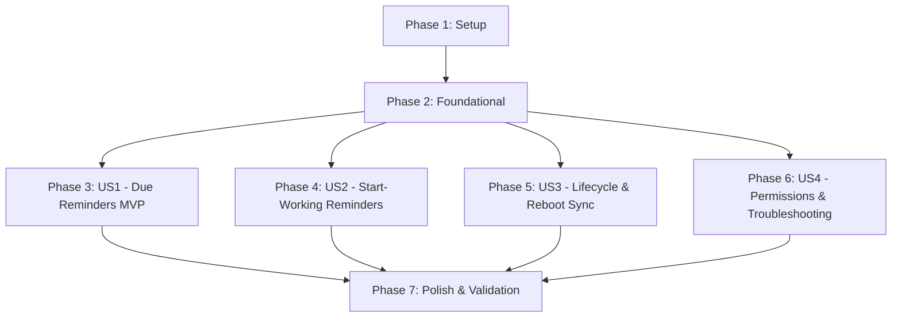

# Tasks: Resilient Task Reminders & Notifications (Phase 2)

**Input**: Design documents from `specs/002-task-reminders/` (`spec.md`, `plan.md`, `research.md`, `data-model.md`, `contracts/`, `quickstart.md`, `design/screens/`)  
**Prerequisites**: `spec.md`, `plan.md`, `data-model.md`, `contracts/reminder_service_contract.md`, `quickstart.md`

## Format: `- [ ] [ID] [P?] [Story?] Description with file path`

- **[P]**: Can run in parallel (different files, no blocking dependencies)
- **[Story]**: User story mapping (`[US1]`, `[US2]`, `[US3]`, `[US4]`). Excluded for Setup, Foundational, and Polish phases.

---

## Phase 1: Setup (Shared Infrastructure)

**Purpose**: Project dependencies, Android platform manifest permissions, localization, and routing initialization.

- [X] T001 Add dependencies `flutter_local_notifications: ^18.0.1` and `timezone: ^0.10.0` with one-line justifications to `pubspec.yaml`
- [X] T002 [P] Configure Android permissions (`RECEIVE_BOOT_COMPLETED`, `SCHEDULE_EXACT_ALARM`, `POST_NOTIFICATIONS`) and declare `ScheduledNotificationBootReceiver` and `ScheduledNotificationReceiver` in `android/app/src/main/AndroidManifest.xml`
- [X] T003 [P] Add English reminder localization strings (reminder toggle, lead times, quick action labels, permission primer copy, troubleshooting guide, diagnostic labels) in `l10n/app_en.arb`
- [X] T004 [P] Add Arabic localization strings with RTL formatting in `l10n/app_ar.arb`
- [X] T005 [P] Register route name `RouteNames.reminderTroubleshooting = '/reminder-troubleshooting'` in `lib/core/routes/route_names.dart`, register provider in `lib/core/routes/route_providers.dart`, and add route builder case in `lib/core/routes/app_router.dart`

---

## Phase 2: Foundational (Blocking Prerequisites)

**Purpose**: Core storage schema migration, Freezed entities, preference keys, and base `IReminderService` singleton.

**⚠️ CRITICAL**: No user story work can begin until this phase is complete.

- [X] T006 Define `RemindersTable` with `id` (text PK), `taskId` (text FK to tasks cascade), `type` (text 'due' or 'start_working'), `scheduledTime` (dateTime), `leadTimeMinutes` (int default 0), `status` (text default 'pending'), `notificationId` (int), `createdAt`, `updatedAt`, and add `isReminderEnabled` (bool default false), `reminderLeadMinutes` (int nullable), `allDayReminderTime` (text nullable) to `TasksTable` with v1 -> v2 migration strategy in `lib/core/storage/app_database.dart`
- [X] T007 Write Drift schema migration unit test in `test/core/storage/migration_test.dart` verifying upgrade from v1 to v2 preserves existing tasks and creates `RemindersTable`
- [X] T008 [P] Create Freezed `ReminderModel` with `ReminderType` (`due`, `start_working`) and `ReminderStatus` (`pending`, `fired`, `cancelled`, `dismissed`) in `lib/features/tasks/data/models/reminder_model.dart`
- [X] T009 [P] Update `TaskModel` with `@Default(false) bool isReminderEnabled`, `int? reminderLeadMinutes`, `String? allDayReminderTime` in `lib/features/tasks/data/models/task_model.dart`
- [X] T010 [P] Define `ReminderPreferences` keys (`pref_reminder_default_lead_minutes`, `pref_reminder_default_all_day_time`, `pref_exact_alarm_fallback_acknowledged`) in `lib/core/constants/storage_keys.dart` and accessor methods in `lib/core/storage/prefs_service.dart`
- [X] T011 Run code generation `dart run build_runner build --delete-conflicting-outputs` to generate Drift, Freezed, and JSON serializers
- [X] T012 Implement `IReminderService` interface and `ReminderServiceImpl` class with `@LazySingleton(as: IReminderService)` in `lib/core/services/reminder_service.dart` implementing plugin initialization, Android channels (`gotit_reminders_channel`, `gotit_missed_reminders_channel`), and runtime permission checks

**Checkpoint**: Foundation ready — user story implementation can begin.

---

## Phase 3: User Story 1 - Due Date Reminders with Configurable Lead Times (Priority: P1) 🎯 MVP

**Goal**: Enable users to attach due date reminders to tasks with selectable lead times (At due time, 5m, 15m, 30m, 1h, 1d) and receive reliable system notifications.

**Independent Test**: Create a task with a due time 2 minutes in the future and reminder set to "At due time", verify notification chimes in notification shade with title, context tag, and due time, tapping which opens task details.

### Tests for User Story 1
- [ ] T013 [P] [US1] Write unit tests for due reminder trigger time calculation and deterministic notification ID generation in `test/core/services/reminder_service_test.dart`
- [ ] T021 [P] [US1] Write widget tests for `TaskFormSheet` reminder toggle, lead time selection, and all-day alert time picker in `test/features/tasks/ui/widgets/task_form_sheet_reminders_test.dart`

### Implementation for User Story 1
- [ ] T014 [P] [US1] Create shared reusable `ReminderLeadTimeChips` widget in `lib/core/widgets/reminder_lead_time_chips.dart` with selectable full-pill chips (`At due time`, `5m before`, `15m before [Default]`, `30m before`, `1h before`, `1d before`) consuming `AppColors.accent` and `AppColors.accentSoft`
- [ ] T015 [US1] Implement due reminder scheduling in `ReminderServiceImpl.syncRemindersForTask` (`lib/core/services/reminder_service.dart`) scheduling exact or inexact alarms via `flutter_local_notifications`'s `zonedSchedule`
- [ ] T016 [US1] Update `TaskLocalDataSource` and `TaskLocalDataSourceImpl` in `lib/features/tasks/data/datasources/task_local_data_source.dart` and `lib/features/tasks/data/datasources/task_local_data_source_impl.dart` with reminder CRUD methods (`insertReminder`, `getRemindersForTask`, `updateReminderStatus`, `deleteRemindersForTask`)
- [ ] T017 [US1] Update `TaskRepositoryImpl` in `lib/features/tasks/data/repositories/task_repository_impl.dart` to invoke `reminderService.syncRemindersForTask(task)` upon `createTask` and `updateTask`
- [ ] T018 [US1] Update `TaskFormCubit` and `TaskFormState` in `lib/features/tasks/cubit/task_form_cubit.dart` and `lib/features/tasks/cubit/task_form_state.dart` with reminder toggle (`toggleReminder`), lead time selection (`setReminderLeadMinutes`), and all-day alert time (`setAllDayReminderTime`)
- [ ] T019 [US1] Add Reminders section to `TaskFormSheet` in `lib/features/tasks/ui/widgets/task_form_sheet.dart` matching approved mockup `01-reminders-modal-en-light.png` with reminder switch, `ReminderLeadTimeChips`, and all-day time picker
- [ ] T020 [US1] Update `TaskCard` in `lib/features/tasks/ui/widgets/task_card.dart` to render subtle reminder bell icon badge (`🔔 15m`) next to due time matching approved mockup `05-task-card-reminder-en.png`

**Checkpoint**: User Story 1 complete and independently testable as an MVP.

---

## Phase 4: User Story 2 - Start-Working Reminders Based on Effort Estimate (Priority: P2)

**Goal**: Automatically trigger a secondary "Start Working" reminder prior to the deadline based on the task's estimated effort (`due - effort`).

**Independent Test**: Create a task due at 4:00 PM with an effort estimate of 45 minutes, verify that a distinct start-working notification is scheduled for 3:15 PM with body *"Time to start working on [Task] — due in 45m"*.

### Tests for User Story 2
- [ ] T022 [P] [US2] Write unit tests for start-working reminder trigger time calculation (`dueDate - effortMinutes`) and past-time suppression in `test/core/services/reminder_service_start_working_test.dart`
- [ ] T025 [P] [US2] Write widget tests for start-working helper card visibility and dynamic calculation in `test/features/tasks/ui/widgets/start_working_helper_test.dart`

### Implementation for User Story 2
- [ ] T023 [US2] Implement start-working reminder scheduling in `ReminderServiceImpl.syncRemindersForTask` in `lib/core/services/reminder_service.dart` to calculate trigger time `due - effort` and schedule secondary notification when `effortMinutes > 0` and target time is in the future
- [ ] T024 [US2] Add `StartWorkingHelperCard` to `TaskFormSheet` in `lib/features/tasks/ui/widgets/task_form_sheet.dart` dynamically displaying lead-time notice (e.g., *"🔔 Start-working reminder will sound at 3:15 PM (45m lead time)"*) when effort is selected

**Checkpoint**: User Stories 1 & 2 functional and independently testable.

---

## Phase 5: User Story 3 - Resilient Lifecycle Synchronization & Reboot Persistence (Priority: P3)

**Goal**: Ensure reminders survive device reboots, immediately cancel on completion/deletion/rescheduling, support tray quick actions ("Mark as Done" and "Snooze 15m"), and bundle missed shutdown reminders.

**Independent Test**: Mark a task complete, verify pending alarm is cancelled immediately in < 150ms. Simulate device reboot, verify future alarms are restored and missed shutdown alarms appear as a single consolidated summary notification.

### Tests for User Story 3
- [ ] T026 [P] [US3] Write unit and repository tests for lifecycle cancellation and rescheduling on task edit/complete/delete in `test/features/tasks/data/repositories/task_repository_reminders_test.dart`

### Implementation for User Story 3
- [ ] T027 [US3] Update `TaskRepositoryImpl` in `lib/features/tasks/data/repositories/task_repository_impl.dart` to call `reminderService.cancelForTask(taskId)` inside `toggleTaskStatus`, `deleteTask`, and upon task rescheduling
- [ ] T028 [US3] Create top-level `@pragma('vm:entry-point')` background action handler in `lib/core/services/notification_action_handler.dart` implementing `NotificationActionIds.markDone` (updates task status to completed in database) and `NotificationActionIds.snooze15m` (re-arms alarm for 15 minutes)
- [ ] T029 [US3] Implement `ReminderServiceImpl.restoreAndReconcileSchedule` in `lib/core/services/reminder_service.dart` querying SQLite database on startup/boot, re-scheduling future alarms, and posting a consolidated missed summary notification (`NotificationActionIds.missedSummaryNotificationId`) for elapsed shutdown alarms
- [ ] T030 [US3] Wire notification payload deep-linking in `lib/core/routes/app_router.dart` and `lib/core/services/reminder_service.dart` routing tapped notifications to `RouteNames.taskDetail` with `TaskDetailArgs(taskId: id)`
- [ ] T031 [US3] Hook `reminderService.restoreAndReconcileSchedule()` into app initialization sequence in `lib/bootstrap.dart`

**Checkpoint**: Lifecycles, boot persistence, and tray quick actions fully synchronized.

---

## Phase 6: User Story 4 - Permission Onboarding & Battery Optimization Guidance (Priority: P4)

**Goal**: Deliver educational pre-permission primer modal, graceful inexact alarm fallback banner, and comprehensive OEM battery troubleshooting screen.

**Independent Test**: Launch fresh install, verify educational primer precedes OS notification permission dialog; deny exact alarms, verify inexact fallback banner appears and directs to `ReminderTroubleshootingScreen`.

### Tests for User Story 4
- [ ] T037 [P] [US4] Write golden tests for `PermissionPrimerDialog` and `ReminderTroubleshootingScreen` across Light, Dark, and Arabic RTL layouts in `test/features/tasks/ui/reminder_troubleshooting_screen_test.dart` and `test/features/tasks/ui/widgets/permission_primer_dialog_test.dart`

### Implementation for User Story 4
- [ ] T032 [P] [US4] Create reusable `PermissionStatusBadge` widget in `lib/core/widgets/permission_status_badge.dart` supporting active (`#DCF0E4`), inexact (`#FAF0C8`), and disabled states
- [ ] T033 [P] [US4] Create `PermissionPrimerDialog` modal sheet in `lib/features/tasks/ui/widgets/permission_primer_dialog.dart` matching approved mockups `02-permission-primer-en-light.png` and `02-permission-primer-ar-light.png`
- [ ] T034 [US4] Implement educational primer trigger logic in `TaskFormSheet` (`lib/features/tasks/ui/widgets/task_form_sheet.dart`) displaying `PermissionPrimerDialog` prior to invoking OS permission dialogs
- [ ] T035 [US4] Add `InexactAlarmWarningBanner` in `TaskFormSheet` (`lib/features/tasks/ui/widgets/task_form_sheet.dart`) matching approved mockup `01-reminders-modal-inexact-warning.png` when exact alarm permission is restricted
- [ ] T036 [US4] Build `ReminderTroubleshootingScreen` in `lib/features/tasks/ui/reminder_troubleshooting_screen.dart` matching approved mockups `03-reminder-reliability-en-light.png`, `03-reminder-reliability-ar-light.png`, and `03-reminder-reliability-en-dark.png` with system diagnostics card and OEM accordion guides

**Checkpoint**: Permissions, graceful degradation, and OEM troubleshooting complete.

---

## Phase 7: Polish & Cross-Cutting Concerns

**Purpose**: Verification, code formatting, static analysis, architecture compliance, and AST graph synchronization.

- [ ] T038 Execute automated verification scenarios from `specs/002-task-reminders/quickstart.md`
- [ ] T039 Run `dart format .` and verify 0 formatting diffs
- [ ] T040 Run `flutter analyze` and ensure 0 errors, warnings, and lints
- [ ] T041 Run `dart run tool/check_architecture.dart` and ensure 0 architecture violations
- [ ] T042 Update AST knowledge graph with `graphify update .`

---

## Dependencies & Execution Order

### Phase Dependencies
- **Phase 1 (Setup)**: Can start immediately. No prerequisites.
- **Phase 2 (Foundational)**: Depends on Phase 1 completion. **BLOCKS** all user stories.
- **Phase 3 (User Story 1 - P1 🎯 MVP)**: Depends on Phase 2. Can be implemented and verified as a standalone MVP.
- **Phase 4 (User Story 2 - P2)**: Depends on Phase 2 and integrates with US1 for task creation and effort calculations.
- **Phase 5 (User Story 3 - P3)**: Depends on Phase 2 and integrates with US1/US2 for lifecycle cancellation and boot recovery.
- **Phase 6 (User Story 4 - P4)**: Depends on Phase 2 and integrates with US1 form sheet for permission primers and settings.
- **Phase 7 (Polish)**: Depends on all user stories (Phases 3–6) being complete.

### Parallel Opportunities
- **Phase 1 (Setup)**: T002, T003, T004, T005 can run in parallel.
- **Phase 2 (Foundational)**: T008, T009, T010 can run in parallel.
- **Phase 3 (US1)**: T013, T014, T021 can run in parallel.
- **Phase 4 (US2)**: T022 and T025 can run in parallel.
- **Phase 6 (US4)**: T032, T033, T037 can run in parallel.

---

## Implementation Strategy

### MVP Milestone (Phases 1, 2, & 3)
1. Complete Phase 1 (Dependencies, Android manifest, l10n strings).
2. Complete Phase 2 (Drift table v2, Freezed models, `ReminderServiceImpl`).
3. Complete Phase 3 (User Story 1: `TaskFormSheet` reminder section, lead-time chips, due reminder scheduling).
4. **STOP and VALIDATE**: Verify due reminders fire on time with accurate lead times.

### Incremental Delivery (Phases 4, 5, 6, & 7)
1. Add Phase 4 (User Story 2): Effort-based start-working reminders.
2. Add Phase 5 (User Story 3): Immediate cancellation on task completion, lock screen quick actions, and boot restoration with missed alarm bundling.
3. Add Phase 6 (User Story 4): Educational permission primer, inexact fallback banner, and OEM battery troubleshooting guide.
4. Run Phase 7 (Polish): Quality gates (`flutter analyze`, `check_architecture`, `quickstart.md`, `graphify update`).
